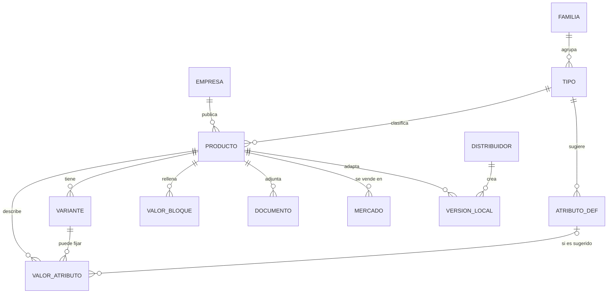

# Modelo de producto por familia

Guía para desarrollo. Versión 1.0 · 14/10/2026. Los datos completos están en `familias.json`.

## Cómo se construye una ficha

1. **Ficha común**: los mismos campos para cualquier producto (ver tabla).
2. **Arquetipo de la familia**: decide el eje de las variantes, el botón principal y los bloques extra.
3. **Bloques de la familia**: grupos de campos estructurados (p. ej. Dosificación, Instalación y servicio).
4. **Atributos del tipo**: sugeridos, ninguno obligatorio. Más atributos propios (nombre, valor, unidad). Solo los numéricos con unidad pueden ser comparables.

Regla general: lo que queda vacío no se publica.

## Clasificación de la empresa

- Al crear la empresa se eligen, de forma obligatoria, **especies** (`especies.json`), **rama de negocio** (lista del CRM, `ramas_y_cargos.json`; una o varias, la primera es la principal; si tiene subrama se elige la subrama) y **mercados**.
- Cada persona tiene un **cargo** (lista del CRM). Los servicios indican «Dirigido a» con ramas y cargos.
- Sirve para que la empresa aparezca en el buscador aunque no tenga productos.
- Con productos publicados, la clasificación se calcula a partir de ellos (especies de Aplicación y familia/tipo de cada producto). El buscador da más peso a lo calculado; lo declarado sin productos que lo respalden pesa menos.
- Si lo declarado y lo calculado no coinciden, se avisa a la empresa para que lo revise.

## Especies y mercados

**Especies** (`especies.json`): 7 especies, categorías y, en pollos de engorde, un tercer nivel. Elegir un nivel incluye todo lo de debajo. Empresa: obligatorio a nivel de especie, afinar opcional. Producto (Aplicación): hasta el último nivel. Buscador: una búsqueda por «Broilers» encuentra lo marcado como Broilers, Pollos de engorde o Avicultura; lo más concreto puntúa más.

**Mercados**: un único selector con búsqueda. Niveles: 1 región del mundo (Europa, UE, Latinoamérica…, lista propia), 2 país (ISO 3166-1), 3 región del país (ISO 3166-2), 4 provincia (solo donde haga falta, para zonas de comerciales y distribuidores). Elegir un nivel incluye todo lo de debajo; se guardan inclusiones y excepciones (`incluye: [UE]`, `excepto: [VE]`). Mismo componente en empresa, producto (Mercados), zonas de comerciales y acuerdos de distribución. El comprador indica su provincia una vez.

## Entidades

- `VALOR_ATRIBUTO`: `atributo_def_id` (si es sugerido) o `nombre_libre`; `valor`; `unidad`; `variante_id` opcional.
- `VALOR_BLOQUE`: `bloque_key` + `data` (JSON validado con el esquema del bloque); `variante_id` si el bloque es por variante.
- `VERSION_LOCAL`: solo puede sobrescribir idioma, presentaciones disponibles, documentos locales, contacto y enlace a tienda.

## Ficha común

| Campo | Tipo | Obligatorio | Nota |
|---|---|---|---|
| Nombre comercial | text | Sí |  |
| Referencia | text | Sí |  |
| Subtítulo | text |  | máx. 90 |
| Descripción corta | text | Sí | máx. 300 |
| Descripción completa | richtext |  |  |
| Galería | images | Sí | mín. 1, máx. 12 |
| Vídeo con capítulos | video |  |  |
| Familia | ref | Sí |  |
| Tipo de producto | ref | Sí |  |
| Formato | list |  |  |
| Especies y fase productiva | ref |  | Clasificación común de Agroolink |
| Objetivos | list |  |  |
| Beneficios clave | list |  | máx. 5, con icono |
| Documentos | doc |  | Con idioma y visibilidad |
| Certificaciones | list |  |  |
| Mercados | ref | Sí | mín. 1 país |
| Distribuidores | ref |  | Vienen de los acuerdos de distribución |
| Productos relacionados | ref |  | Automáticos o manuales |

## Arquetipos

| Arquetipo | Variantes por | Botón principal | Para qué |
|---|---|---|---|
| Insumo | embalaje | Solicitar información | Se vende por peso o volumen y se dosifica. Variantes por embalaje. |
| Sanitario regulado | presentación | Solicitar información | Medicamentos y biocidas. Registro por país y, a veces, receta veterinaria. |
| Genético | formato | Solicitar información | Material vivo o reproductivo. Se valora por índices y estatus sanitario. |
| Equipo e instalación | configuración | Pedir presupuesto | Máquinas e instalaciones. Se configuran, se instalan y tienen servicio técnico. |
| Digital | plan | Solicitar demo | Software, sensores y plataformas. Se contrata por plan o licencia y se integra con otros sistemas. |

## Nutrición animal y aditivos

- **Arquetipo:** Insumo · variantes por embalaje · botón «Solicitar información»
- **Tipos (17):** Piensos completos, Piensos complementarios, Premezclas, Núcleos nutricionales, Acidificantes, Probióticos, Prebióticos, Enzimas, Fitogénicos, Adsorbentes de micotoxinas, Aminoácidos, Vitaminas, Minerales y oligoelementos, Grasas y aceites, Conservantes y antioxidantes, Sustitutos lácteos, Aditivos tecnológicos
- **Con comparador al lanzamiento:** Piensos completos, Probióticos, Enzimas, Aminoácidos, Vitaminas

**Bloques**

- Dosificación (`dosificacion`, pestaña Especificaciones, tabla): Especie y fase; Dosis *; Unidad; Vía
- Conservación (`conservacion`, pestaña Especificaciones): Vida útil [meses]; Temperatura máxima [°C]; Condiciones

**Documentos:** Ficha técnica (Público); Ficha de seguridad (SDS) (Usuarios registrados); Certificado de análisis (Solo distribuidores)

**Reglas**

- La dosis se informa por especie y fase de Aplicación; no se duplica la especie.
- La autorización o registro del aditivo va en Mercados, por país.

## Materias primas y productos agrícolas

- **Arquetipo:** Insumo · variantes por embalaje · botón «Pedir cotización»
- **Tipos (7):** Cereales, Harinas proteicas, Subproductos agroindustriales, Forrajes, Aditivos para ensilado, Conservantes de materias primas, Productos para almacenamiento
- **Con comparador al lanzamiento:** ninguno

**Bloques**

- Análisis típico (`analisis`, pestaña Especificaciones, tabla): Parámetro; Valor *; Unidad; Método
- Origen y logística (`origen_logistica`, pestaña Especificaciones): Origen; Campaña o cosecha; Pedido mínimo [t]; Punto de entrega
- Conservación (`conservacion`, pestaña Especificaciones): Vida útil [meses]; Temperatura máxima [°C]; Condiciones

**Documentos:** Ficha técnica (Público); Certificado de análisis (Solo distribuidores); Ficha de seguridad (SDS) (Usuarios registrados)

**Reglas**

- CTA propio: «Pedir cotización». El precio cambia por campaña y no se publica.
- El análisis es típico o medio; se puede indicar por lote en la versión local.

## Salud animal y bioseguridad

- **Arquetipo:** Sanitario regulado · variantes por presentación · botón «Solicitar información»
- **Tipos (10):** Vacunas, Antibióticos veterinarios, Antiparasitarios, Antiinflamatorios, Desinfectantes, Productos de higiene, Diagnóstico rápido, Kits PCR / laboratorio, Equipos de vacunación, Control de plagas
- **Con comparador al lanzamiento:** ninguno

**Bloques**

- Registro y prescripción (`registro_prescripcion`, pestaña Mercados y dónde comprar): Requiere receta veterinaria *; Registro por país *; Periodo de retirada
- Administración (`administracion`, pestaña Especificaciones): Vía; Pauta; Conservación [°C]

**Documentos:** Prospecto / resumen de características (Según país); Ficha técnica (Público); Ficha de seguridad (SDS) (Usuarios registrados); Certificado de registro por país (Solo distribuidores)

**Reglas**

- Si requiere receta: aviso «Medicamento sujeto a prescripción veterinaria» y el contacto va solo a distribuidores autorizados o al fabricante.
- Sin nº de registro en un país, el producto no se publica en ese país.
- La publicidad de medicamentos tiene límites por país: validar textos con el área legal.

## Genética y reproducción

- **Arquetipo:** Genético · variantes por formato · botón «Solicitar información»
- **Tipos (7):** Líneas genéticas porcinas, Genética avícola, Genética bovina, Semen y dosis seminales, Embriones, Equipos de inseminación, Equipos de incubación reproductiva
- **Con comparador al lanzamiento:** ninguno

**Bloques**

- Índices y rendimiento (`rendimiento`, pestaña Resultados, tabla): Parámetro *; Valor *; Unidad; Fuente *; Fecha
- Estatus sanitario (`sanidad_genetica`, pestaña Documentación): Estatus sanitario; Certificados sanitarios

**Documentos:** Catálogo de índices (Público); Certificado sanitario (Usuarios registrados); Ficha técnica (Público)

**Reglas**

- Cada índice publicado lleva fuente y fecha.
- Los equipos de este grupo (inseminación, incubación) usan los bloques de «Equipo e instalación».

## Equipamiento e instalaciones ganaderas

- **Arquetipo:** Equipo e instalación · variantes por configuración · botón «Pedir presupuesto»
- **Tipos (15):** Comederos, Bebederos, Sistemas de alimentación automática, Sistemas de ventilación, Sistemas de calefacción, Refrigeración y cooling, Iluminación ganadera, Suelos y slats, Jaulas y alojamientos, Equipos de ordeño, Robots de ordeño, Sistemas de limpieza, Sistemas de gestión de estiércol, Silos y almacenamiento, Básculas y sistemas de pesaje
- **Con comparador al lanzamiento:** Sistemas de ventilación, Sistemas de calefacción, Jaulas y alojamientos, Robots de ordeño, Básculas y sistemas de pesaje

**Bloques**

- Dimensiones y capacidad (`dimensiones`, pestaña Especificaciones, por variante): Largo × ancho × alto [mm]; Peso [kg]; Capacidad
- Energía y consumos (`energia`, pestaña Especificaciones, por variante): Potencia [kW]; Alimentación eléctrica; Consumo [kWh/día]
- Instalación y servicio (`instalacion`, pestaña Especificaciones): Plazo de entrega [semanas]; Montaje incluido; Garantía [años]; Servicio técnico; Repuestos disponibles
- Normativa (`normativa`, pestaña Documentación): Marcado CE; Normas que cumple

**Documentos:** Ficha técnica (Público); Manual de instalación y uso (Usuarios registrados); Declaración CE de conformidad (Usuarios registrados); Planos y CAD (Solo distribuidores)

**Reglas**

- Las variantes son configuraciones: la capacidad y las dimensiones van por variante.
- La solicitud de presupuesto llega con la configuración elegida.

## Equipamiento avícola especializado

- **Arquetipo:** Equipo e instalación · variantes por configuración · botón «Pedir presupuesto»
- **Tipos (8):** Incubadoras, Nacedoras, Clasificadoras de huevos, Sistemas de recogida de huevos, Nidos, Equipos de procesamiento avícola, Sistemas de aturdimiento, Equipos de vacunación in ovo
- **Con comparador al lanzamiento:** Incubadoras, Clasificadoras de huevos

**Bloques**

- Dimensiones y capacidad (`dimensiones`, pestaña Especificaciones, por variante): Largo × ancho × alto [mm]; Peso [kg]; Capacidad
- Energía y consumos (`energia`, pestaña Especificaciones, por variante): Potencia [kW]; Alimentación eléctrica; Consumo [kWh/día]
- Instalación y servicio (`instalacion`, pestaña Especificaciones): Plazo de entrega [semanas]; Montaje incluido; Garantía [años]; Servicio técnico; Repuestos disponibles
- Normativa (`normativa`, pestaña Documentación): Marcado CE; Normas que cumple

**Documentos:** Ficha técnica (Público); Manual de instalación y uso (Usuarios registrados); Declaración CE de conformidad (Usuarios registrados); Planos y CAD (Solo distribuidores)

**Reglas**

- Mismo modelo que Equipamiento e instalaciones ganaderas; cambian los tipos y sus atributos sugeridos.

## Equipamiento porcino especializado

- **Arquetipo:** Equipo e instalación · variantes por configuración · botón «Pedir presupuesto»
- **Tipos (5):** Estaciones electrónicas de alimentación, Equipos de alimentación líquida, Sistemas de maternidad, Sistemas de detección de partos, Equipos de procesado de lechones
- **Con comparador al lanzamiento:** ninguno

**Bloques**

- Dimensiones y capacidad (`dimensiones`, pestaña Especificaciones, por variante): Largo × ancho × alto [mm]; Peso [kg]; Capacidad
- Energía y consumos (`energia`, pestaña Especificaciones, por variante): Potencia [kW]; Alimentación eléctrica; Consumo [kWh/día]
- Instalación y servicio (`instalacion`, pestaña Especificaciones): Plazo de entrega [semanas]; Montaje incluido; Garantía [años]; Servicio técnico; Repuestos disponibles
- Normativa (`normativa`, pestaña Documentación): Marcado CE; Normas que cumple

**Documentos:** Ficha técnica (Público); Manual de instalación y uso (Usuarios registrados); Declaración CE de conformidad (Usuarios registrados); Planos y CAD (Solo distribuidores)

**Reglas**

- Mismo modelo que Equipamiento e instalaciones ganaderas.

## Equipamiento para rumiantes

- **Arquetipo:** Equipo e instalación · variantes por configuración · botón «Pedir presupuesto»
- **Tipos (7):** Robots de alimentación, Mezcladoras unifeed, Sistemas de detección de mastitis, Sistemas de refrigeración de leche, Equipos de análisis de leche, Sistemas de separación de animales, Cepillos automáticos
- **Con comparador al lanzamiento:** Mezcladoras unifeed, Sistemas de refrigeración de leche

**Bloques**

- Dimensiones y capacidad (`dimensiones`, pestaña Especificaciones, por variante): Largo × ancho × alto [mm]; Peso [kg]; Capacidad
- Energía y consumos (`energia`, pestaña Especificaciones, por variante): Potencia [kW]; Alimentación eléctrica; Consumo [kWh/día]
- Instalación y servicio (`instalacion`, pestaña Especificaciones): Plazo de entrega [semanas]; Montaje incluido; Garantía [años]; Servicio técnico; Repuestos disponibles
- Normativa (`normativa`, pestaña Documentación): Marcado CE; Normas que cumple

**Documentos:** Ficha técnica (Público); Manual de instalación y uso (Usuarios registrados); Declaración CE de conformidad (Usuarios registrados); Planos y CAD (Solo distribuidores)

**Reglas**

- Mismo modelo que Equipamiento e instalaciones ganaderas.

## Sostenibilidad, medio ambiente y energía

- **Arquetipo:** Equipo e instalación · variantes por configuración · botón «Pedir presupuesto»
- **Tipos (8):** Biodigestores, Separadores sólido-líquido, Tratamiento de aguas, Sistemas de reducción de emisiones, Energía solar para granjas, Sistemas de recuperación de calor, Equipos de compostaje, Soluciones de gestión de residuos
- **Con comparador al lanzamiento:** ninguno

**Bloques**

- Dimensiones y capacidad (`dimensiones`, pestaña Especificaciones, por variante): Largo × ancho × alto [mm]; Peso [kg]; Capacidad
- Energía y consumos (`energia`, pestaña Especificaciones, por variante): Potencia [kW]; Alimentación eléctrica; Consumo [kWh/día]
- Instalación y servicio (`instalacion`, pestaña Especificaciones): Plazo de entrega [semanas]; Montaje incluido; Garantía [años]; Servicio técnico; Repuestos disponibles
- Impacto ambiental (`impacto`, pestaña Resultados): Reducción declarada [%]; Sobre qué; Fuente del dato *; Subvencionable

**Documentos:** Ficha técnica (Público); Manual de instalación y uso (Usuarios registrados); Estudio de impacto o ahorro (Público); Declaración CE de conformidad (Usuarios registrados)

**Reglas**

- Todo dato de reducción o ahorro lleva fuente.
- Si es subvencionable, se muestra una etiqueta en la ficha y en el buscador.

## Tecnología, sensores y software

- **Arquetipo:** Digital · variantes por plan · botón «Solicitar demo»
- **Tipos (9):** Sensores de actividad y collares, Software de gestión ganadera, Sensores ambientales, Sistemas de identificación RFID, Cámaras de visión artificial, Plataformas IoT, Sistemas de trazabilidad, Software de formulación, Sistemas de alimentación de precisión
- **Con comparador al lanzamiento:** Sensores de actividad y collares

**Bloques**

- Compatibilidad e integraciones (`compatibilidad`, pestaña Especificaciones): Se integra con; API abierta; Protocolos; Idiomas; Requisitos
- Hardware (`hardware`, pestaña Especificaciones): Autonomía [días]; Conectividad; Protección

**Documentos:** Ficha técnica (Público); Documentación de la API (Usuarios registrados); Tratamiento de datos (RGPD) (Público); Manual de instalación y uso (Usuarios registrados)

**Reglas**

- El bloque Hardware solo aparece si el producto tiene un dispositivo físico.
- Las variantes son planes; el precio del plan es opcional y por defecto no se muestra.

`*` = obligatorio dentro del bloque si el bloque se usa.
